# Agent workflow

This is the portable source of truth for Splitiful's agent roles and feature
delivery process. Tool-specific entry points should invoke these roles and
link here instead of maintaining their own version of the stage order or
approval rules. The current Claude adapters live in `.claude/agents/` and
`.claude/skills/feature/`; `AGENTS.md` and `CLAUDE.md` point contributors to
this document.

## Team roles

| Role | Owns | Does not own |
|---|---|---|
| Planning facilitator | Discovery, independent PM and strategy input, recommendation, unresolved user decisions | Final scope approval or requirements |
| Product strategist | Independent assessment of user value, opportunity cost, risk, and simpler options | Requirements or implementation |
| PM | Scope, acceptance criteria, risk surface, and roadmap entry | UX or technical design |
| Compliance reviewer | Privacy, retention, communications, financial-record, and consumer-claim review | Legal advice or feature redesign |
| Security reviewer | Threat review of requirements, design, and implementation | Implementation fixes |
| Architect | Data model, module boundaries, migration/API strategy, impact analysis, ADRs, and the current-state `architecture/` and `reference/` pages | Feature implementation |
| UX designer | User flows, states, copy, responsive behavior, and consistency with existing UI | Backend/data decisions |
| Engineer | Application and migration implementation against approved artifacts | Product decisions or final independent QA |
| QA | Acceptance, edge-case, and regression verification; QA report | Implementation fixes |
| Documentation engineer | README, guide, runbook and reference updates; changelog proposal; version recommendation; doc-page placement and checks per [Write documentation](guides/writing-docs.md) | Application logic or release action |
| PR prep reviewer | Final diff and project-check review; draft commit message | Commit, push, release, or PR creation |

Role-specific instructions may add detail, but should not contradict this
document's ownership boundaries or workflow gates.

## Pipeline diagram

```mermaid
flowchart TD
    Start([Feature idea]) --> Plan[Planning facilitator<br/>PM + product strategist debate]
    Plan --> C1{Checkpoint 1<br/>User chooses direction}
    C1 --> PM[PM writes requirements + roadmap]
    PM --> Risk{Any risk-surface item?}
    Risk -->|Yes| EarlyReview[Security + compliance<br/>requirements review in parallel]
    EarlyReview --> Fold[PM folds constraints into requirements]
    Risk -->|No: record why skipped| C2
    Fold --> C2{Checkpoint 2<br/>User approves requirements}
    C2 --> Design[Architect + UX designer<br/>work in parallel]
    Design --> DesignRisk{Early risk review ran?}
    DesignRisk -->|Yes| DesignReview[Security + compliance<br/>design review in parallel]
    DesignReview --> DesignGate{Blocking design gaps?}
    DesignGate -->|Yes| Design
    DesignGate -->|No| Engineer[Engineer implements]
    DesignRisk -->|No| Engineer
    Engineer --> QA[QA verifies acceptance + regressions]
    QA --> QAGate{QA passes?}
    QAGate -->|No| Engineer
    QAGate -->|Yes| FinalReview[Security + compliance<br/>final review in parallel]
    FinalReview --> FinalGate{Blocking findings?}
    FinalGate -->|Yes| Engineer
    FinalGate -->|No| Docs[Docs engineer updates docs + changelog proposal]
    Docs --> Prep[PR prep reviews diff + checks]
    Prep --> C3{Checkpoint 3<br/>User reviews final result}
    C3 --> Done([Complete after approval])
```



The three checkpoints are required stops. QA or blocking final-review findings
send the work back through implementation and verification before it advances.

## Feature delivery stages

1. **Plan.** The planning facilitator gathers independent PM and product
   strategy views, records the recommendation and unresolved decisions in
   `docs/features/<slug>/planning.md`.
2. **User checkpoint: direction.** Present the recommendation and open
   decisions. Wait for the user's explicit direction before writing formal
   requirements.
3. **Requirements.** PM writes acceptance criteria, non-goals, risk surface,
   and the roadmap entry in `docs/features/<slug>/requirements.md` and
   `docs/product/roadmap.md`.
4. **Early risk review.** If any risk-surface item is present, security and
   compliance review requirements. PM incorporates their constraints into
   acceptance criteria and non-goals. Record why this review was skipped
   when every risk item is `none`.
5. **User checkpoint: requirements.** Present the scope, risk surface, and
   constraints. Wait for explicit approval or revisions before design.
6. **Architecture and UX.** Architect and UX designer produce their feature
   documents. Architect updates the matching `docs/architecture/` page and
   `docs/reference/data-model.md` or `code-map.md` when the system's
   current state changes (current state only, no "as of feature X"
   history), and records consequential decisions as ADRs with a row in
   the ADR index.
7. **Design risk review.** When early review ran, security and compliance
   check that their constraints appear in the architecture and design.
   Resolve blocking gaps before implementation.
8. **Implement and verify.** Engineer implements against approved
   requirements, architecture, design, and risk constraints. QA verifies
   acceptance criteria, relevant regressions, and project checks. Fix
   failures and repeat verification before continuing.
9. **Final security and compliance review.** Review the implementation and
   resolve blocking findings before documentation and PR preparation. A
   late blocking finding should identify the missed earlier check and
   propose a rule for the corresponding baseline.
10. **Documentation and PR preparation.** Documentation engineer updates
    relevant docs and proposes changelog/version changes. PR prep reports
    checks and diff findings.
11. **User checkpoint: completion.** Present review findings, proposed
    documentation/version changes, security/compliance results, baseline
    additions, and a draft commit message. Wait for approval. Do not commit,
    push, change the release version, or open a PR without authorization.

## Shared rules

- User decisions are hard gates. Do not infer approval from silence or
  continue past a checkpoint while its answer is pending.
- Surface product, UX, architecture, or legal decisions to the user instead
  of silently choosing when the decision materially changes scope or risk.
- Keep `docs/product/roadmap.md` as a concise status index and the
  `docs/architecture/` and `docs/reference/` pages as the current-state
  system reference. Keep feature-specific rationale, review evidence, and
  history in `docs/features/<slug>/` and review records, linked from those
  pages.
- Follow [Write documentation](guides/writing-docs.md) for every doc change:
  one page type per page, the shared template, current state only in
  concept, guide and reference pages, and `npm run docs:check` passing.
- ADRs preserve decisions and rationale; do not use them as a substitute
  for describing the system as it works today.
- Security and compliance constraints are implementation requirements.
  Blocking findings are gates, not advisory notes.
- When a review identifies a missing standing rule, update
  `docs/reviews/security-compliance/project/security-baseline.md` or `docs/reviews/security-compliance/project/compliance-baseline.md` with the fix.
- Keep handoffs concise: report what changed, what was verified, what failed
  or deviated, and what decision or action is next.

## Feature artifact map

Feature records are point-in-time evidence. Not every feature needs every
artifact, but any skipped risk review or stage should be explained in its
feature record.

```text
docs/features/<slug>/
  planning.md                 discovery and unresolved decisions
  requirements.md             approved scope and acceptance criteria
  architecture.md             technical design and consumer impact
  design.md                   user flows, states, and copy
  qa-report.md                 verification evidence
```

Security and compliance artifacts live separately under
`docs/reviews/security-compliance/features/<slug>/`:

```text
  security-constraints.md     early security requirements, when applicable
  compliance-constraints.md   early compliance requirements, when applicable
  security-report.md          final security review, when applicable
  compliance-report.md        final compliance review, when applicable
```

## Documentation map

Which role updates which page. The placement rules and page template are in
[Write documentation](guides/writing-docs.md).

| Page or area | Updated by | When |
|---|---|---|
| `docs/architecture/*.md` | Architect | A pattern, access rule or mechanism changes |
| `docs/reference/data-model.md`, `code-map.md` | Architect (design), documentation engineer (verify) | A table, policy, RPC, trigger or shared module changes |
| `docs/reference/analytics-events.md` | Documentation engineer | An event is added, renamed or removed |
| `docs/product/roadmap.md` | PM (entry), documentation engineer (status) | A feature is scoped, shipped or released |
| `docs/product/principles.md` | PM, with user approval | A product principle or non-goal changes |
| `docs/adr/` and its index | Architect | A decision has real alternatives |
| `docs/guides/`, `docs/runbooks/` | Documentation engineer | A procedure changes |
| `docs/features/<slug>/` | The stage's role | Per feature; point-in-time, not rewritten later |
| `docs/reviews/` | Security, compliance, QA | Dated; not rewritten later |
| `CHANGELOG.md` | Documentation engineer | Proposal at the docs stage |
