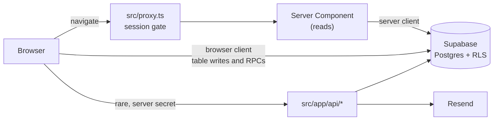

# Architecture overview

Splitiful is a Next.js 16 (App Router) app on Vercel, backed by Supabase for auth, Postgres and row-level security (RLS), with Resend for transactional email. This page is the map: the stack, the five patterns that shape every feature, and where to read next.

## Stack

| Layer | Technology | Notes |
|---|---|---|
| Frontend | Next.js 16 App Router, TypeScript, Tailwind CSS | Server Components by default |
| Auth | Supabase Auth | Anonymous sessions plus six-digit email OTP |
| Database | Supabase Postgres | RLS is the authorization boundary |
| Email | Resend | Used only by `src/app/api/trip-email/route.ts` |
| Rate limiting | Upstash Redis | App-level, plus Postgres-side for invite RPCs |
| Hosting | Vercel | Analytics and Speed Insights mounted in the root layout |

## How a request flows

## The five patterns

| Pattern | Rule | Read more |
|---|---|---|
| **Direct-client mutations** | Writes go from client components to Supabase. RLS and `security definer` RPCs authorize them. There is no route handler in that path. | [Mutations](mutations.md) |
| **Server-rendered reads** | Pages that fetch data are Server Components. Interactivity lives in small `"use client"` leaves. | [Rendering](rendering.md) |
| **Three-tier access** | A trip's summary needs no session. Detail needs a verified member or the owner. Writes need a verified member. | [Auth](auth.md) |
| **Locking** | A completed trip is read-only. Every write path checks `is_trip_open`. | [Mutations](mutations.md#locking) |
| **Additive migrations** | Schema changes ship before the app code that uses them. | [Apply a schema change](../guides/apply-a-schema-change.md) |

## Reading order

1. This page.
2. [Mutations](mutations.md), [Rendering](rendering.md), [Auth](auth.md): the patterns, in that order.
3. [Data model](../reference/data-model.md): tables, policies and RPCs.
4. [Code map](../reference/code-map.md): shared modules to reuse before writing new ones.
5. [Telemetry](telemetry.md) and [Performance](performance.md): analytics, timing and query rules.

## Why

Putting authorization in RLS keeps the rule next to the data, so a bug in client code can't widen access. Direct-client writes remove a server hop and a layer to keep in sync. See [ADR 0005](../adr/0005-ssr-page-conversion-pattern.md) and [ADR 0006](../adr/0006-anonymous-auth-and-otp-linking-for-onboarding.md).

## Related

- [User flow diagram](user-flow.html) (open in a browser)
- [ADR index](../adr/README.md)
- [Roadmap](../product/roadmap.md)

Last verified: 2026-10-20 against 9a951bb
