# System Design Knowledge Base

A learning companion for the
[system-design-primer](https://github.com/donnemartin/system-design-primer)
course, taught using **this repo (Splitiful)** as the running example.

This is a learning reference, not the source of truth for current behavior.
For current product status, architecture, and security/compliance rules, use
the [roadmap](../product/roadmap.md), [architecture](../architecture/overview.md), and the baselines
linked from the [documentation index](../README.md). Examples here may lag behind
the application as it changes.

**Who this is for:** you don't need a programming background to read this.
Every technical term is defined the first time it shows up. Each section
goes **high-level summary → diagram → Splitiful example → deep dive**, so
you can stop as soon as you have enough, or keep going for the full
picture.

**How to view the diagrams:** they're written in [Mermaid](https://mermaid.js.org/),
a text-based diagram format. GitHub renders them automatically. In VS Code,
install the "Markdown Preview Mermaid Support" extension (or similar) and
open Preview, or view this file on GitHub.

---

## Contents

0. [Foundations — words you need before anything else](#0-foundations--words-you-need-before-anything-else)
1. [The big picture — Splitiful end to end](#1-the-big-picture--splitiful-end-to-end)
2. [Functional and non-functional requirements](#2-functional-and-non-functional-requirements)
3. [Single server](#3-single-server)
4. [DNS and CDN](#4-dns-and-cdn)
5. [Load balancer and reverse proxy](#5-load-balancer-and-reverse-proxy)
6. [Application layer: monolith, modular monolith, and microservices](#6-application-layer-monolith-modular-monolith-and-microservices)
7. [Database: relational, replication, sharding](#7-database-relational-replication-sharding)
8. [Caching](#8-caching)
9. [Asynchronism and queues](#9-asynchronism-and-queues)
10. [Communication: REST vs. RPC vs. GraphQL](#10-communication-rest-vs-rpc-vs-graphql)
11. [Security](#11-security)
12. [Scaling roadmap: current → future](#12-scaling-roadmap-current--future)
13. [Containers: Vercel's model vs. Docker, and when to switch](#13-containers-vercels-model-vs-docker-and-when-to-switch)
14. [Glossary](#14-glossary)

---

## 0. Foundations — words you need before anything else

Skip this section once these feel obvious.

- **Client** — the thing making a request. Usually a web browser (Chrome,
  Safari) that a person is using. In Splitiful, "the client" means the app
  running in your browser tab.
- **Server** — a computer (or, more often today, a program running
  somewhere in the cloud) that waits for requests and responds to them. It
  doesn't call you; you call it.
- **Request / response** — the basic unit of communication on the web. The
  client sends a *request* ("give me the trip page for trip #42"), the
  server sends back a *response* (the HTML/data for that page, or an
  error). This round trip is the atom that everything in this document is
  built out of.
- **API (Application Programming Interface)** — a defined way for one
  program to ask another program to do something, without needing to know
  how it's built internally. Think of it as a restaurant menu: you don't
  need to know how the kitchen works, you just need to know what you're
  allowed to order and what you'll get back.
- **Database** — a program specialized in storing data durably (it
  survives restarts) and letting you query it ("find all expenses for trip
  #42"). Splitiful's database is **Postgres**, a specific well-known
  database engine, hosted for us by a service called **Supabase**.
- **Frontend vs. backend** — frontend is the part that runs in the user's
  browser and draws the screen. Backend is the part that runs on a server,
  holds the real data, and enforces the rules. Splitiful blurs this line
  more than most apps — more on that in [§6](#6-application-layer-monolith-modular-monolith-and-microservices).
- **Latency** — how long a request takes. Lower is better. Most of system
  design is techniques for keeping latency low as more people use the
  system at once.
- **Scaling** — handling more users/data/traffic without everything
  slowing down or falling over. "Vertical scaling" = give one machine more
  power (bigger CPU/RAM). "Horizontal scaling" = use more machines instead
  of one bigger one.

---

## 1. The big picture — Splitiful end to end

Before zooming into each topic, here's the whole system in one diagram —
every request Splitiful handles flows through some subset of these boxes.

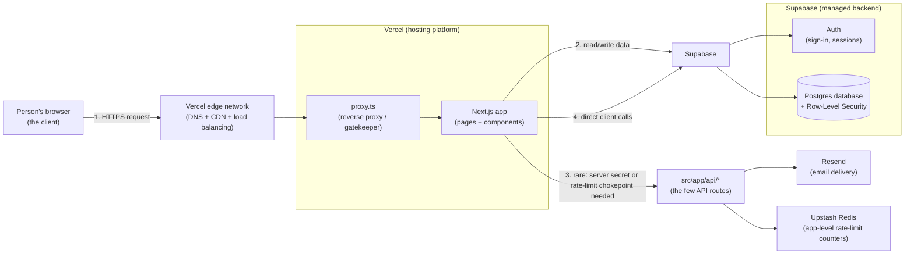

**Read it like this:** your browser never talks to the database directly —
it talks to Vercel, which either serves a page or forwards the request
into Supabase (for almost all reads/writes) or into a small API route. That
API route exists for one of two reasons: it needs a secret the browser must
never see (sending email through Resend), or it needs to act as a
rate-limit chokepoint in front of a guessable-credential RPC (the
invite-code lookup and join routes, backed by Upstash Redis — see
[§11](#11-security)). Every later section is a deep dive into one arrow or
box in this picture.

---

## 2. Functional and non-functional requirements

### High-level summary
Before anything gets built, the primer says to pin down two different
kinds of requirements:

- **Functional requirements (FRs)** — what the system must actually *do*.
  The features. The things a user can go and use.
- **Non-functional requirements (NFRs)** — how *well* it needs to do
  those things. Not a feature by itself, but a quality that every feature
  has to satisfy: how fast, how reliable, how secure, how much it can
  grow.

A simple analogy: for a restaurant, "serves pasta" is functional.
"Food arrives within 20 minutes" and "food is safe to eat" are
non-functional — they don't add a menu item, they constrain how every
menu item gets delivered.

This matters because **almost every architectural choice in this whole
document is really an answer to an NFR**, not a feature request. Nobody
asked Splitiful to "have Row-Level Security" as a feature — RLS exists to
satisfy the *security* NFR. Nobody asked for "a reverse proxy" as a
feature — it exists to satisfy part of that same NFR with a better user
experience. Reading the rest of this document with that lens — "which
requirement is this choice actually serving?" — is the single most useful
habit for understanding *why* a system looks the way it does, not just
*what* it does.

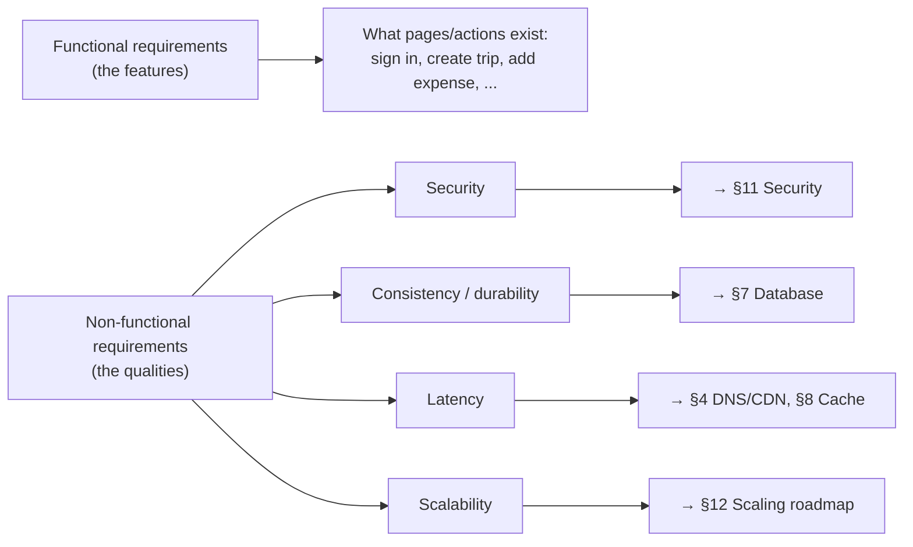

### Splitiful's functional requirements
Pulled directly from what actually exists under `src/app/`, i.e. what a
user can actually go do today. Every one of these is a "yes/no, does the
feature exist and work" question — that's the tell that it's functional,
not non-functional.

### Mapping each one to the backend component responsible for it

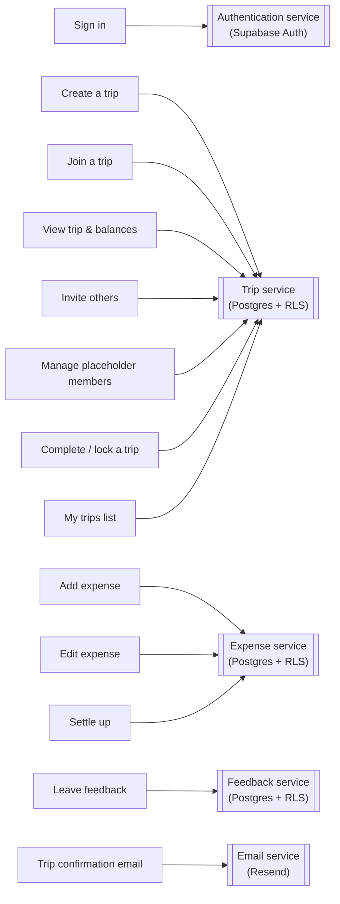

**The honest caveat:** Splitiful doesn't literally have four separate
services — "Trip," "Expense," and "Feedback" here are the same Postgres
database, just different tables with their own RLS rules. Only
**Authentication** (Supabase Auth) and **Email** (Resend) are
genuinely separate systems. Drawn this way on purpose, though: it's the
same shape a microservices version of Splitiful would take if those
boxes ever *did* become real, independent services — see [§6](#6-application-layer-monolith-modular-monolith-and-microservices)
for why that split isn't worth making today.

### Splitiful's non-functional requirements
These are rarely written down as a checklist anywhere (they aren't
explicitly listed in this repo's docs either) — usually they're implicit
in the design choices already made. Making them explicit here:

| NFR | What it actually asks | Splitiful's current answer | Covered in |
|---|---|---|---|
| **Availability** | Can users reach the app when they try to? | Inherits whatever uptime Vercel + Supabase provide; no extra redundancy is built on top of that in this repo | [§5](#5-load-balancer-and-reverse-proxy), [§7](#7-database-relational-replication-sharding) |
| **Consistency** | Does everyone see the same, latest data? | Strong/immediate — there's exactly one Postgres instance and no replicas, so there's no lag to reason about (yet) | [§7](#7-database-relational-replication-sharding) |
| **Latency** | How fast does the app respond? | No permanent measurement anywhere in this repo, but the performance-scaling feature added *interim* per-call timing instrumentation (`src/lib/perf/timing.ts`) that logs p50/p95-computable durations for the slowest surfaces — temporary and log-based, not a real APM, see [ADR 0010](../adr/0010-interim-per-call-timing-instrumentation.md). A follow-up October 2026 performance code review used that instrumentation's own captured log data to confirm one real, still-open finding and flag one latent indexing gap — see the [October 2026 performance review](../reviews/performance-review-2026-10.md) rather than repeating it here | [§4](#4-dns-and-cdn), [§8](#8-caching), [§12](#12-scaling-roadmap-current--future) |
| **Scalability** | How much growth can it absorb before something needs to change? | See the full breakdown | [§12](#12-scaling-roadmap-current--future) |
| **Security** | Can only the right people see/change the right data? | Row-Level Security is the actual enforcement boundary; sign-in is a one-time passcode; sensitive actions go through least-privilege `security definer` functions; the two guessable-invite-code RPCs are additionally rate-limited at both the app layer (Upstash Redis) and inside Postgres itself, so a caller can't bypass the limit by skipping the app entirely | [§11](#11-security) |
| **Durability** | Does data survive a crash or restart? | Yes — Postgres persists to disk on Supabase's managed side. Backup/disaster-recovery policy isn't something this repo configures or documents — it's inherited from the platform | [§7](#7-database-relational-replication-sharding) |
| **Cost** | What does running it cost? | Usage-based, serverless pricing on both Vercel and Supabase — no dedicated always-on server sitting idle | *(a platform choice, outside this repo's code)* |
| **Maintainability** | How safely can it be changed later? | Small monolith, one typed data-access module ([`src/lib/data/trips.ts`](../../src/lib/data/trips.ts)), sequential migrations, and ADRs recording *why* key decisions were made | [§6](#6-application-layer-monolith-modular-monolith-and-microservices) |

### Deep dive — NFRs trade off against each other, they don't stack for free
This is the part that makes NFRs harder to reason about than FRs: you
can't usually improve one for free — most of the time you're trading it
against another one. Splitiful's **Consistency** row is a good live
example: it's "strong" today only because there's a single database
instance. The moment Splitiful added a read replica to help with
**Scalability** (the hypothetical move flagged in
[§12](#12-scaling-roadmap-current--future) at ~10K users), it would be
trading a little bit of that consistency away — a replica can lag the
primary by a fraction of a second, so a user could briefly read
slightly-stale data right after a write. Neither choice is "wrong"; it's
a genuine trade, and knowing *which* NFR you're spending to buy *which*
other NFR is most of what system design actually is.

The other habit worth building from this section: whenever you read a
design decision anywhere in this document (or in any real codebase) and
it's not obvious *why* it was done that way, try asking "which
non-functional requirement was this protecting?" before assuming it was
arbitrary. Most of the time, it wasn't.

---

## 3. Single server

### High-level summary
The simplest possible system design: one computer runs everything — the
part that talks to users and the part that stores data. No copies, no
splitting work across machines. This is where every system starts, and
it's where Splitiful still is today, just built on managed cloud
platforms instead of one physical box.

### Splitiful example
Splitiful doesn't literally run on one box, but it's the same *shape*: one
tier of application code (the Next.js app on
[Vercel](https://vercel.com)) talking to one tier of storage (one Postgres
database on [Supabase](https://supabase.com)). There's no second copy of
the database, no cluster of app servers behind a shared cache — just app
→ database, once each.

### Deep dive
The primer's whole narrative is: start here, then add pieces (more
servers, a cache, a database copy, a queue) **only when a specific problem
shows up** — too many users for one server, the database is now the
bottleneck, one slow feature is blocking fast ones, etc. Every section
below is "the next piece you'd add, and the problem it solves." Splitiful
hasn't needed most of them yet — and that not needing them is itself a
correct design decision at its current size, not a gap. Adding a piece
before you need it costs you complexity for nothing in return.

---

## 4. DNS and CDN

### High-level summary
- **DNS (Domain Name System)** — the internet's phone book. You type a
  name like `splitiful.app`; DNS looks up the actual server address
  (an "IP address," a number like `76.76.21.21`) that name points to.
  Without it, you'd have to memorize numbers instead of names.
- **CDN (Content Delivery Network)** — a network of servers spread around
  the world that keep copies of files that don't change often (images,
  CSS, JavaScript bundles) close to wherever the user physically is, so
  they load fast no matter where the user is on the globe.

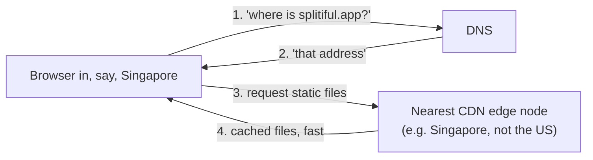

### Splitiful example
Both are handled entirely by Vercel — there's no DNS or CDN configuration
anywhere in this repo. Vercel's platform resolves the domain and serves
static assets (the compiled JavaScript, images, fonts) from edge
locations automatically. This is a case where the *right* engineering
decision was to use a platform that solves it, rather than build it.

### Deep dive
Nothing in this repo to go deeper on — this is infrastructure Splitiful
consumes, not code it owns. Worth knowing it exists so that when you read
"the app feels slow for users overseas," you know CDN/DNS is a possible
culprit to rule out, separate from anything in `src/`.

---

## 5. Load balancer and reverse proxy

These are two different tools that often get confused, so they're covered
together on purpose.

### High-level summary
- **Load balancer** — when you have *multiple* copies of your app server
  running (for capacity or reliability), something has to decide which
  copy handles each incoming request, and spread the load evenly.
- **Reverse proxy** — a program that sits in front of your app and
  intercepts *every* request before your actual page/feature code runs, to
  do some check or transformation first (redirect, block, rewrite,
  log...). It's "reverse" because it's a proxy acting on behalf of the
  *server*, not the client.

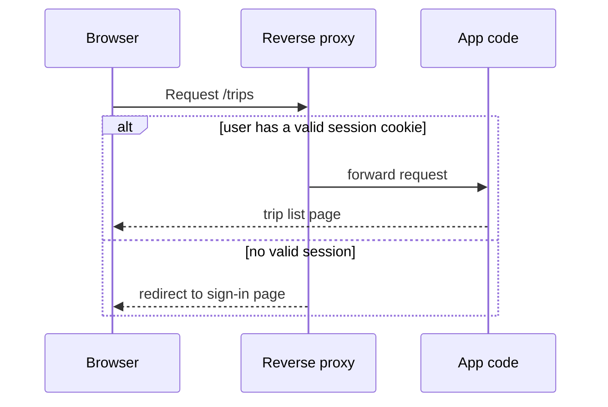

### Splitiful example — this one's real code, not a platform feature
[`src/proxy.ts`](../../src/proxy.ts) is a genuine reverse proxy running on
every request (except static files — see the `matcher` at the bottom of
the file). What it does, in order:

1. Checks whether the requested path even needs a session at all (see
   `SESSION_REQUIRED_PATTERNS`, [line 16](../../src/proxy.ts#L16)) — if not, it
   skips the whole auth check and lets the request through immediately
   ([lines 27–29](../../src/proxy.ts#L27-L29)), specifically so pages that
   don't need it aren't slowed down by an extra network round trip.
2. If the path *does* require a session, it asks Supabase "is this a
   signed-in user?" ([lines 53–55](../../src/proxy.ts#L53-L55)).
3. If there's no signed-in user, it redirects to the sign-in flow instead
   of ever running that page's code ([lines 57–61](../../src/proxy.ts#L57-L61)).
   Otherwise, it lets the request continue through.

**As of the redesign-ui feature, three path patterns require a session**
(`SESSION_REQUIRED_PATTERNS = [/^\/trips/, /^\/feedback/, /^\/you/]`) —
`/trip/new` and `/trip/[id]*` deliberately don't: a trip can be created
by, or a trip page viewed by, a fully anonymous visitor (an anonymous
Supabase session created client-side, or no session at all for a
summary-only invite preview). This is a narrower gate than it used to be —
worth knowing if you're reading older discussion of this file that
mentions a `PROTECTED_PATTERNS` list covering more routes, or a
`SESSION_REQUIRED_PATTERNS` that only named `/trips`.

The **load balancer** half doesn't exist as code in this repo — Vercel's
platform spins up app instances on demand and spreads traffic across them
invisibly. There's no config file for it because there's nothing to
configure; it's part of what you're paying the platform for.

### Deep dive — the important nuance
Read the comment on [lines 5–7 of proxy.ts](../../src/proxy.ts#L5-L7): it
calls the proxy's check **"optimistic"** and says *the real enforcement is
Postgres Row-Level Security*. This is a deliberate, load-bearing design
decision: the proxy is a **convenience redirect** (so a signed-out user
gets a sign-in screen instead of a broken page), not a **security
boundary**. If someone bypassed the proxy entirely, they still couldn't
read or write data they shouldn't — because the database itself refuses
it, regardless of what the proxy did or didn't check. That's the "defense
in depth" principle from the primer's security section, and it's why §11
of this doc and §5 both point at the same file for different reasons.

**A proposed, not-yet-executed evolution of this file:** `/trips` still
pays *two* sequential Supabase-Auth-server round trips per request — one
inside this proxy check, one again inside the page itself (it needs the
user id for `getMyTrips`, and doesn't trust the proxy to have guaranteed a
session for reasons the primer would call "the proxy check is optimistic,
not authoritative"). [ADR 0011](../adr/0011-forward-verified-user-id-header-for-trips-page.md)
proposes having the proxy forward its own verified user id to the page via
a trusted request header, explicitly overwriting any client-supplied value
of the same name — but it's gated behind real latency data from the
performance-scaling feature showing the extra round trip is actually
costly enough to justify introducing a new trust boundary. It's a good
concrete example of *why* NFR trade-offs get written down (§2) rather than
just made silently: this one isn't built yet, on purpose.

**Update, October 2026 performance review:** the *page's* half of this
(`/trips`'s own `getUser()` call) has since been changed to run
concurrently with its `trips` data fetch instead of sequentially before it
— one fewer sequential stage than when the paragraph above was written.
The proxy's own `getUser()` call (the first of the two round trips) is
untouched, and still isn't directly measured by the app's own timing
instrumentation, so ADR 0011's proposal above is still exactly where it
was: a real idea, still not acted on, still waiting on its own latency
number. See the [October 2026 performance review](../reviews/performance-review-2026-10.md) for the full detail, not repeated here.

---

## 6. Application layer: monolith, modular monolith, and microservices

### High-level summary
- **Monolith** — one application, one codebase, one deployment, containing
  all the features. Simple to build and reason about; the whole thing
  scales (and fails) together.
- **Microservices** — the same features split into several small,
  independently-deployed services (e.g., a "users service," a "payments
  service") that talk to each other over the network. More flexible at
  large scale, but adds real complexity: now services need to find each
  other, handle each other being slow or down, and you need to debug
  problems that span multiple services instead of one.

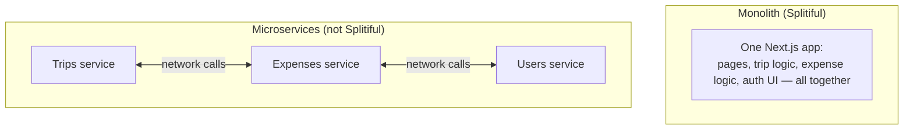

### Splitiful example
Splitiful is a monolith, and deliberately so — see
[the architecture overview](../architecture/overview.md). But there's a more
interesting wrinkle than "monolith vs. microservices": **most of
Splitiful's app layer is skipped entirely.**

In a typical monolith, the browser talks to your server code, and *your
server code* talks to the database. Splitiful mostly doesn't do that —
client components (code running in the browser) call the Supabase client
library **directly**, which talks straight to the database, skipping a
custom backend layer for most operations:

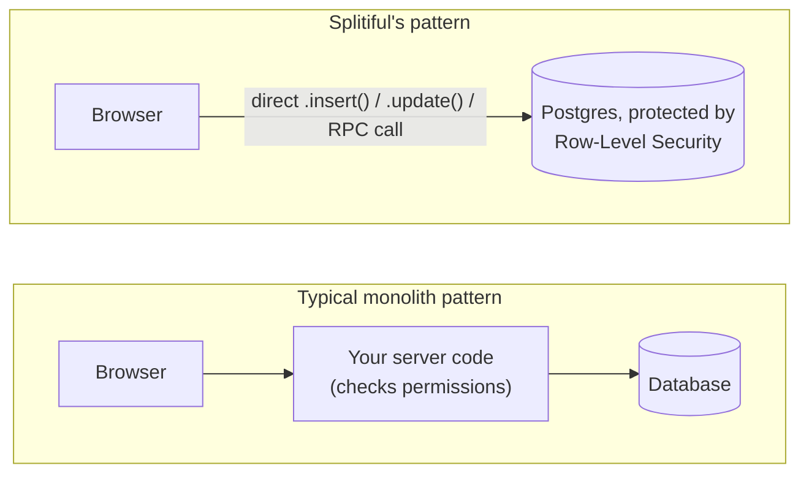

The one data-access module that wraps all of this is
[`src/lib/data/trips.ts`](../../src/lib/data/trips.ts) — every trip/expense
read or write in the whole app funnels through its typed functions
(`createTrip`, `joinTrip`, `addExpense`, `getTripView`, etc.), even though
those functions call the database directly rather than calling a custom
backend.

A real backend route (`src/app/api/`) shows up for two reasons. The first is
a **secret the browser must never see** — e.g.
[`src/app/api/trip-email/route.ts`](../../src/app/api/trip-email/route.ts)
needs the Resend API key, which can't be shipped to a browser (the
browser is fully open to anyone using developer tools — anything sent to
it is effectively public). The second, added later, is narrower but just
as real: a **rate-limit chokepoint** in front of an RPC that's guessable
or low-entropy — see [`src/app/api/trip-invite/[code]/route.ts`](../../src/app/api/trip-invite/[code]/route.ts)
and [`src/app/api/join/route.ts`](../../src/app/api/join/route.ts), covered in
[§11](#11-security). Neither of those two routes needs a secret; they exist
purely so a rate limiter (which only runs inside Vercel/Next.js, not
inside Supabase) actually sits in the request's path.

### Deep dive
Why is "skip the backend, trust the database's own permission system"
even safe? Because Postgres has a feature called **Row-Level Security
(RLS)** that lets the *database itself* enforce "who can read/write which
rows," rather than trusting application code to remember to check every
time. That's covered fully in [§11](#11-security) — it's the load-bearing
idea that makes this whole pattern hold together, so treat this section
and that one as two halves of the same story.

### Comparing the three, side by side — in Splitiful's terms

"Modular monolith" is the middle option the primer doesn't spend much
time on: same single deployment as a monolith, but the *code* is
organized into modules with enforced boundaries, the way microservices
are organized into separate services — without paying for a network
between them.

| | **Monolith** | **Modular monolith** | **Microservices** |
|---|---|---|---|
| **Deployment** | Single unit — the one Vercel deployment Splitiful has today | Single unit — still one Vercel deployment; modules ship together even though the code is separated | Multiple, independent units — e.g. a separate "trips service" and a separate "email service," each deployed on its own schedule |
| **Codebase** | Single, large codebase — today's `src/` tree, where most things are reachable from most things | Single codebase, but split into enforced modules — e.g. a `trips/` module, an `expenses/` module, an `auth/` module, each only exposing a defined interface | Multiple smaller codebases, one per service, often each with its own repo |
| **Coupling** | Tightly coupled — nothing stops a new page from bypassing [`src/lib/data/trips.ts`](../../src/lib/data/trips.ts) and querying Supabase directly | Loosely coupled modules, but tightly deployed — the trips module and expenses module would only talk through defined functions, but a change to either still ships in the same deploy | Very loosely coupled — trips and expenses would be separate processes talking only over the network; either can change independently as long as the network contract holds |
| **Scalability** | Scale the entire app — more Vercel/Supabase capacity for everything at once, even if only expense-adding is actually hot | Scale the entire app — modularity here is a code-organization idea, it doesn't change what gets deployed or scaled | Scale individual services — e.g. the email-sending piece could get its own capacity/queue, independent of the trip-viewing piece |
| **Operational complexity** | Low — one thing to deploy, one thing to monitor | Low to medium — still one deploy, but you now maintain the discipline of the boundaries themselves (lint rules, documented interfaces) as an ongoing cost | High — multiple deployments, services finding each other, network failures to handle, debugging across services instead of one |
| **Team dynamics** | One team, or teams with heavy coordination — realistically "one team" for Splitiful today | Teams can own a module, but releases stay coupled — starts to matter once more than one person is regularly touching the codebase | Small, autonomous teams can own and deploy a service independently — needs enough people that "one team per service" is realistic |
| **Technology stack** | Single, unified stack — TypeScript/Next.js/Postgres everywhere | Same single unified stack — modularity is organizational, not technological | Polyglot possible — e.g. an email/notification worker could run on a different stack than the main app, since it deploys separately |

**Where Splitiful actually sits:** the **Monolith** column, with a hint of
the **Codebase** row from Modular Monolith already present *informally* —
[`src/lib/data/trips.ts`](../../src/lib/data/trips.ts) and
[`src/lib/validation/expense.ts`](../../src/lib/validation/expense.ts) are
documented as the single entry points for their concerns. But look at the
**Coupling** row: those boundaries aren't enforced by anything, so
Splitiful doesn't get to claim the Modular Monolith column yet — it's a
monolith with good habits, not a modular monolith.

The two moves in this table are triggered by different things, which is
the main reason not to conflate them:

- **Monolith → Modular monolith** is a **codebase/team** trigger, not a
  traffic one — it starts to earn its cost once more contributors are
  regularly touching the code and features start colliding, per the
  recommendation already in this doc's discussion above. Splitiful isn't
  there yet.
- **Modular monolith → Microservices** is a **scalability/team-dynamics**
  trigger specifically — one piece needing to scale or deploy
  independently of the rest. The one concrete Splitiful candidate for
  this, if it ever came up, is exactly the one flagged in the
  [§12 scaling roadmap](#12-scaling-roadmap-current--future)'s §6 row at
  ~100K+ users: extracting email/notifications into their own service.
  Nothing else in Splitiful has a real independent-scaling need today.

---

## 7. Database: relational, replication, sharding

### High-level summary
- **Relational database (RDBMS)** — stores data in tables with rows and
  columns, like a very disciplined spreadsheet, where tables can reference
  each other (a `trip_members` row points at *which* `trip` it belongs
  to). Postgres, the database Splitiful uses, is relational.
- **Replication** — keeping one or more *copies* of the database in sync,
  usually so reads can be spread across copies (more capacity) and so a
  copy survives if the main one fails.
- **Sharding** — splitting one huge database into multiple smaller
  databases, each holding a slice of the data (e.g., trips A–M on one
  database, N–Z on another), because a single database eventually can't
  hold or serve it all.

### Splitiful example — the actual schema
Splitiful's schema (defined in
[`supabase/migrations/`](../../supabase/migrations), one file per change,
applied in order) has four tables:

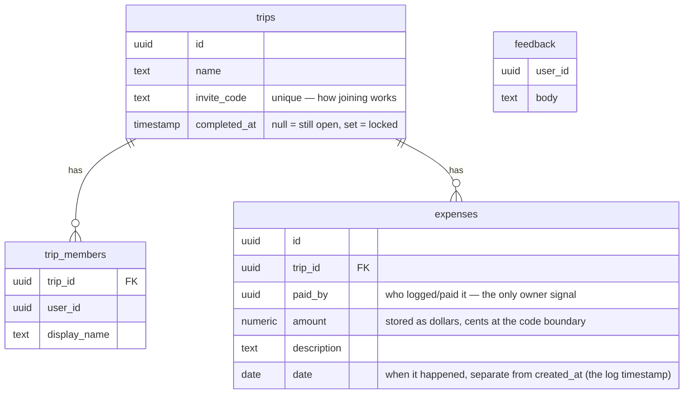

A few things worth noticing as a beginner, because they're common
real-world relational-database decisions, not Splitiful quirks:

- Splitting an expense between trip members isn't stored anywhere — every
  screen that needs "how much does each person owe" **computes it on the
  fly** from the current member count, in
  [`src/lib/settlement.ts`](../../src/lib/settlement.ts). The tradeoff: less
  data to keep in sync (if you edit an expense's amount, there's no
  separate "splits" table to update to match), at the cost of recomputing
  it every time it's needed. For Splitiful's scale, that recompute is
  essentially free, so it's a good trade.
- Money is stored as `numeric(10,2)` (dollars with cents) in the database,
  but converted to whole-number cents at the boundary in
  [`src/lib/currency.ts`](../../src/lib/currency.ts). Doing math in cents
  (integers) avoids the rounding errors you can get from doing arithmetic
  directly on fractional dollar amounts.

**A fifth table exists but isn't in the diagram above on purpose:**
`rpc_rate_limits` (added in `supabase/migrations/0013_throttle_invite_rpcs_in_postgres.sql`)
holds no trip data — it's pure infrastructure, a bucket-counter table backing
the Postgres-side rate limiter covered in [§11](#11-security). It has Row-Level
Security turned on with **zero policies** and no `anon`/`authenticated`
grants at all, so it's unreachable through Supabase's public API even by
mistake — only the `security definer` functions that call it internally
can touch it. A clean, small example of "least privilege" applied to a
table, not just to a feature.

**Replication and sharding don't exist in Splitiful today** — one
Postgres instance, no copies, no splitting. That's correct for its scale.
If Splitiful grew a lot, here's what each would look like:

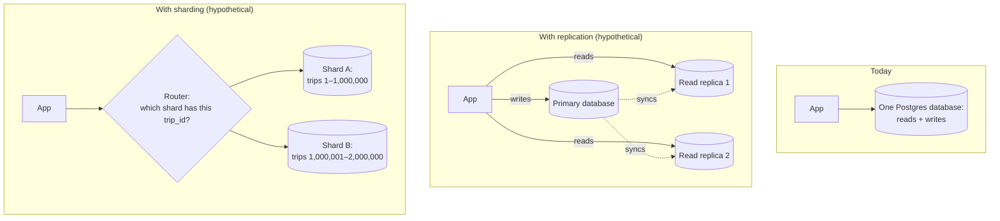

### Deep dive
- **Why replication helps reads:** most apps read data far more often
  than they write it (people check trip balances constantly, but only
  occasionally add an expense). Spreading reads across several synced
  copies means no single database has to handle all that read traffic
  alone. The tradeoff is **replication lag** — a copy might be a fraction
  of a second behind the primary, so a user could theoretically read
  slightly stale data right after a write.
- **Why sharding is a last resort, not a first step:** once you shard by
  `trip_id`, any query that needs to look *across* trips (e.g., a global
  admin report) becomes much harder, because the data isn't all in one
  place anymore. You only take this step once one database provably can't
  keep up — which is nowhere close to true for Splitiful today.
- **Indexing is cheaper and comes first.** Before replication or sharding
  are even on the table, the primer's own ordering is "make sure the
  queries you already run are actually using an index." A October 2026
  performance code review checked this directly against Splitiful's real
  migrations and found almost everything already indexed on the column
  it's actually filtered by (`trip_id` on `expenses`/`trip_members`,
  `invite_code` on `trips`, several on `shopping_list_items`) — with one
  exception, and it teaches something the primer's rule of thumb
  doesn't: `trips`' read policy (`is_trip_member(id) or created_by =
  auth.uid()`) made the `/trips` page check a function against *every*
  trip row in the app. The obvious fix, an index on `created_by`, was
  tested and **does nothing** — Postgres can't use an index through an
  `or` that contains a function call, so it still reads every row. What
  worked was changing the policy so the caller's trip ids are looked up
  once and hashed (migration 0023): on 200k test trips, ~5-9 s dropped
  to ~0.1 s with identical results. The lesson: "add an index" is a
  hypothesis, so check the query plan (`explain analyze`) before
  believing it. about. See the [`trips` and `trip_members` data model](../reference/data-model.md) and the [October 2026 performance review](../reviews/performance-review-2026-10.md)
  for the full detail.

---

## 8. Caching

### High-level summary
A **cache** is a smaller, faster place to store a copy of data (or a
computed result) so that the next time it's needed, you don't have to
redo the slow work (a database query, a heavy calculation) — you just
read the cached copy. The tradeoff is always the same: caches are faster,
but they can go **stale** (show old data) if the real data changes and
the cache isn't updated to match.

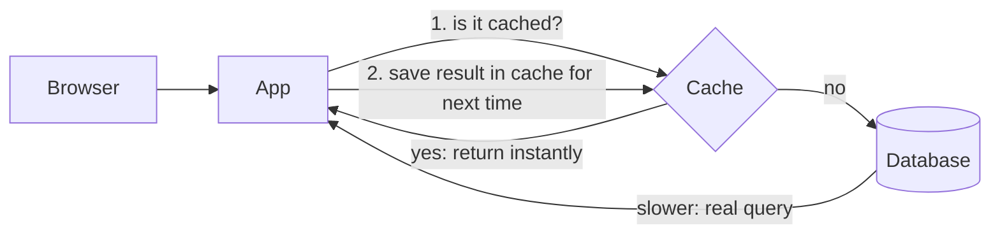

### Splitiful example
There's **no server-side cache for application data** anywhere in
Splitiful — nothing between the app and the database that stores a copy of
trip/expense data to avoid re-querying it. Redis *does* exist in the stack
now ([Upstash](https://upstash.com), via [`src/lib/rate-limit.ts`](../../src/lib/rate-limit.ts))
but it's not a cache in this sense — it only stores rate-limit counters
(see [§11](#11-security)), never a copy of real data, and nothing reads
from it hoping to avoid a slow query. Worth flagging because "Redis is in
the stack" and "Splitiful has a cache" sound like the same fact and
aren't — a rate limiter and a cache solve different problems even though
they're often built on the same kind of fast key/value store. The one
cache-*adjacent* thing that actually serves data is client-side, and it's
narrow on purpose:
[`src/lib/remembered-email.ts`](../../src/lib/remembered-email.ts) uses the
browser's own storage (`localStorage` — a small key/value store built
into every browser, private to that one device) to remember the
last-used sign-in email, purely as a convenience. Per
[the rendering architecture](../architecture/rendering.md#device-local-state), the house rule is: this
kind of storage is only for small, non-sensitive, per-device
conveniences — never for data that needs to be reliable or shared between
devices, and every read/write is wrapped so the feature just quietly
degrades (not breaks) if storage is blocked (e.g. private browsing mode).

### Deep dive
Why doesn't Splitiful have a real cache? Because it doesn't have a
performance problem a cache would fix — its data changes about as often
as it's read (someone adds an expense, then everyone on the trip wants
the *current* balance, not a slightly-stale one), and the dataset per
trip is tiny. Adding a cache here would mean taking on **cache
invalidation** — the genuinely hard problem of making sure the cache gets
updated or thrown away the instant the underlying data changes — for no
real benefit yet. This is the primer's "don't add complexity you don't
need" lesson in its purest form. A October 2026 performance code review
reached the same conclusion from the other direction: the per-call
durations captured by `src/lib/perf/timing.ts` look dominated by
network round-trip time to Supabase, not by query execution against a
tiny per-trip dataset — exactly the "no stale-data problem to justify
caching" profile this section describes, not a hidden recompute cost a
cache would actually fix.

---

## 9. Asynchronism and queues

### High-level summary
Normally, a request/response is **synchronous**: the browser asks, and
waits, until the server finishes everything and replies. If one step in
there is slow (e.g., calling an external email service), the whole
response waits for it. A **message queue** lets you instead say "do this
*eventually*" — drop a task in a queue and respond to the user right
away, while a separate worker processes the queue in the background.

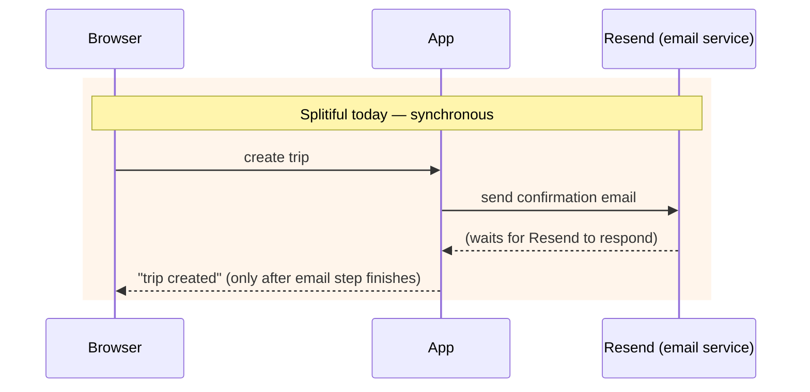

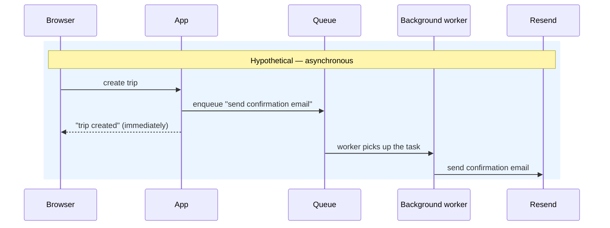

### Splitiful example
[`src/app/api/trip-email/route.ts`](../../src/app/api/trip-email/route.ts)
is exactly the synchronous version: it calls `sendTripEmail(...)`
directly and waits for Resend's response before replying to the browser
([lines 38–44](../../src/app/api/trip-email/route.ts#L38-L44)) — and if
Resend fails, it returns an error (`502`) to the user's browser
([line 47](../../src/app/api/trip-email/route.ts#L47)), even though the
trip itself was already created successfully.

**A narrow, non-queue exception worth distinguishing:** the
performance-scaling feature's client-side timing beacon
(`reportClientTiming` in [`src/lib/perf/timing.ts`](../../src/lib/perf/timing.ts),
posting to `/api/perf-log`) *is* fire-and-forget — the browser doesn't wait
for its response before moving on, using `fetch(..., { keepalive: true })`
wrapped in a `try`/`catch` that swallows any failure silently. That's
genuinely asynchronous in the "don't make me wait" sense, but it's **not**
a queue: there's no retry, no durability, no worker picking it back up if
it fails. It's a fire-and-forget log write, not a task guaranteed to
eventually complete — a useful contrast for telling "asynchronous" and
"queued/reliable" apart, since it's easy to conflate the two.

### Deep dive
There's no real queue anywhere in Splitiful — no background workers,
nothing "eventually consistent" for durable work. That's a reasonable
choice right now: email volume is low, Resend is normally fast, and the
failure mode (user sees "email failed" even though their trip was created
fine) is mild. If Splitiful sent much higher volumes of email, or added
something genuinely slow (e.g., generating a PDF trip summary), a queue is
the primer's standard fix: it decouples "the thing the user is waiting
for" from "the thing that's slow," and adds resilience — if the email
service is briefly down, the task just waits in the queue and retries
instead of failing the user's request outright.

---

## 10. Communication: REST vs. RPC vs. GraphQL

### High-level summary
Once you have a client and a server, they need an agreed-upon *shape* for
requests and responses. Three common styles:

- **REST** — organizes an API around "resources" (nouns) and standard
  verbs: `GET /trips/42` (fetch trip 42), `POST /trips` (create a trip),
  `DELETE /expenses/7` (delete expense 7). Predictable and widely used.
- **RPC (Remote Procedure Call)** — organizes an API around *actions*
  (verbs) instead of nouns: call a named function like
  `completeTrip(tripId)` as if it were a local function, even though it
  actually runs on a server somewhere else.
- **GraphQL** — the client describes exactly which fields it wants back,
  in one request, instead of the server deciding the shape of every
  response ahead of time. Not used anywhere in Splitiful.

### Splitiful example
Splitiful actually mixes the first two, chosen per situation:

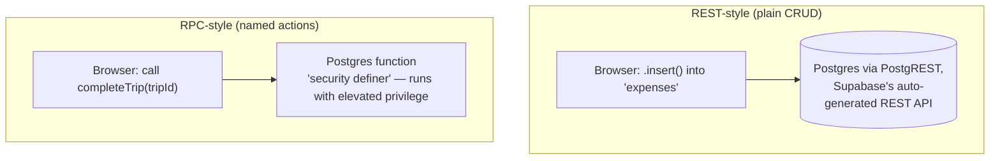

- Simple reads/writes (add an expense, update a trip's name) go through
  Supabase's REST-like table calls: `.insert()`, `.update()`, `.select()`.
- Actions that need extra logic or elevated permission — `create_trip`,
  `join_trip`, `complete_trip` — are **RPC calls** to named Postgres
  functions (see [the mutations architecture](../architecture/mutations.md#locking) for
  `complete_trip`, and the migrations in
  [`supabase/migrations/`](../../supabase/migrations) for how these
  functions are defined). These are marked `security definer`, meaning
  the function runs with the database's own elevated permissions rather
  than the calling user's — which is *why* it's implemented as an RPC
  instead of a plain insert: joining a trip needs to create a
  `trip_members` row, but a regular user isn't allowed to insert into
  that table directly (see [§11](#11-security)), so the action is wrapped
  in a function that's allowed to, and the client can only trigger it
  through that one controlled door.

### Deep dive
Why does the "action" style (RPC) exist at all instead of just using plain
inserts everywhere? Because some operations need to do more than "add one
row" — `join_trip` needs to check the invite code is valid *and* create
the membership row *and* not let a client fabricate membership by
guessing a trip's ID. Wrapping that in a single trusted function is safer
than trying to express all of it as a permission rule on a plain insert.

One more RPC worth knowing about, even though nothing calls it directly
from the browser: `public.throttle_rpc(_bucket_key, _limit, _window_seconds)`
(`supabase/migrations/0013_throttle_invite_rpcs_in_postgres.sql`) is a
shared helper that `get_trip_by_invite_code` and `join_trip` both call as
their *first* statement, before doing any real work — it's the Postgres-side
half of the rate limiting covered in [§11](#11-security). Same "wrap it in
a trusted function" idea as `complete_trip`, just reused for throttling
instead of a business action.

---

## 11. Security

### High-level summary
Two of the primer's core security ideas, both very visible in this repo:

- **Least privilege** — every part of the system should be able to do
  only what it actually needs to, nothing more.
- **Defense in depth** — don't rely on a single checkpoint; layer
  multiple independent checks, so that if one is bypassed or has a bug,
  others still hold.

### Splitiful example — Row-Level Security (RLS)
This is Splitiful's central security mechanism, and it's a great concrete
example of "the database enforces its own rules" rather than trusting
application code to remember to check permissions every time.

**What RLS is, in plain terms:** normally, if your app code can query a
table at all, it can see or change *every* row in it. Row-Level Security
lets you attach a rule directly to the table — enforced by Postgres
itself, no matter what code is asking — so that, e.g., a query against
`expenses` automatically only returns rows for trips *that user actually
belongs to*, even if the application code never explicitly filtered for
that.

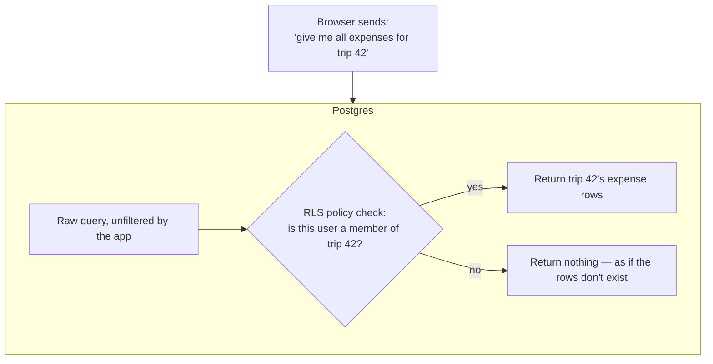

Splitiful's actual policies on the `expenses` table (from
[the data model reference](../reference/data-model.md#rls-policies), defined in the
migrations):

| Action | Who's allowed |
|---|---|
| `select` (read) | any member of that trip |
| `insert` (create) | any trip member, only while the trip is still open, and only if they're inserting it as themselves |
| `update` (edit) | only the member who originally logged that expense, only while the trip is open |
| `delete` | any trip member, on an open trip *(intentionally not yet narrowed — no delete feature exists yet, flagged in the docs as something to revisit when one is built)* |

Two more concrete mechanisms worth knowing:

- **`is_trip_member()` and `is_trip_open()`** — small reusable functions
  that most policies above are built from, rather than every policy
  re-deriving "is this person allowed" from scratch. This is the database
  equivalent of not repeating yourself.
- **Locking a trip** — once a trip is marked completed
  (`trips.completed_at` gets set, via the `complete_trip` RPC, one-way —
  there's no "reopen" action), `is_trip_open()` starts returning false,
  and *every* write-side policy on `expenses` requires it to be true. One
  flag, checked by every relevant policy, locks the entire trip's
  finances at once.

### Deep dive — why this matters more than it might seem
Go back to [§5](#5-load-balancer-and-reverse-proxy) and
[§6](#6-application-layer-monolith-modular-monolith-and-microservices): Splitiful's browser
code talks **directly** to the database for most operations, with no
custom backend in between checking "is this allowed?" That pattern is
only safe *because* RLS exists — the database refuses disallowed
reads/writes on its own, regardless of what the calling code does or
forgets to check. The `proxy.ts` redirect-to-sign-in behavior
([§5](#5-load-balancer-and-reverse-proxy)) is a nice-to-have on top of
that, not a substitute for it — which is exactly the "defense in depth"
idea: even if the proxy check were removed entirely, the actual data
would still be protected by RLS underneath it.

### Splitiful example — Rate limiting (a second layer, not a replacement for RLS)
RLS answers "is this person allowed to see/change this row at all?" It
deliberately doesn't answer a different question: "is this person allowed
to try 10,000 times a second?" A security review
([`docs/reviews/security-compliance/project/security-review-2026-09-17.md`](../reviews/security-compliance/project/security-review-2026-09-17.md))
found exactly that gap: Splitiful's invite codes are only 8 hex characters
(~32 bits of randomness, generated by `md5(random())`), and the two RPCs
that consume one — `get_trip_by_invite_code` (preview a trip from its
invite link) and `join_trip` (actually join it) — had no throttle at all.
Low-entropy codes plus an unlimited number of guesses is a real
brute-force path, even though RLS itself was working exactly as designed
the whole time.

The fix that shipped has **two independent layers**, because the two
layers close two different holes:

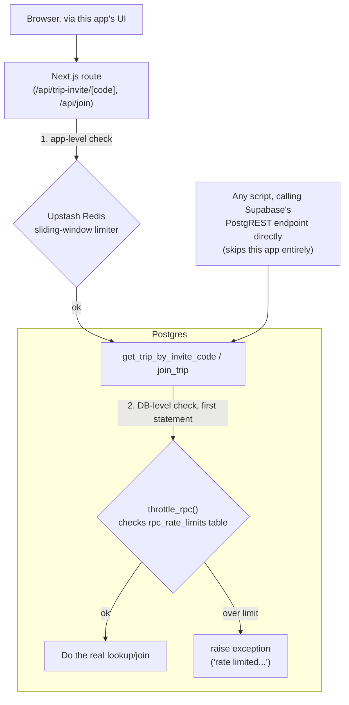

- **Layer 1 — app-level, in `src/app/api/`**: [`src/lib/rate-limit.ts`](../../src/lib/rate-limit.ts)'s
  `enforceRateLimit` checks a per-IP sliding-window counter stored in
  Upstash Redis before either route does any real work, returning a `429`
  with a `Retry-After` header if the caller's over the limit. Deliberately
  **fails closed**: if the Redis credentials aren't configured in
  production, requests are rejected (`503`) rather than silently let
  through unthrottled.
- **Layer 2 — DB-level, inside Postgres itself**: layer 1 only protects
  requests that go through *this app's* Next.js routes. Supabase's
  database is also reachable directly over its own public API (PostgREST)
  with the public anon key — completely bypassing Vercel, and therefore
  bypassing Upstash too. So both RPCs also call `throttle_rpc()`
  ([§10](#10-communication-rest-vs-rpc-vs-graphql)) as their first
  statement, which checks and increments a counter in the
  `rpc_rate_limits` table ([§7](#7-database-relational-replication-sharding))
  and raises an exception once a bucket's count is exceeded within its
  window — a check no caller can route around, because every path to
  these two RPCs passes through the RPC itself.

This is the same "defense in depth" idea as `proxy.ts` vs. RLS, just one
layer further out: even if a caller discovers and skips the app-level
limiter entirely (exactly what the direct-to-Supabase path does), the
database-level throttle still holds — see
[ADR 0009](../adr/0009-throttle-invite-rpcs-inside-postgres.md) for the full
reasoning, including why a *different* fix (revoking the RPCs' public
grants entirely) was rejected specifically for `join_trip`, since that RPC
genuinely needs the caller's own verified identity (`auth.uid()`) to know
who's joining.

### Deep dive — a real lesson about testing DB code
ADR 0009 also records a genuinely useful cautionary tale, not just a
success story. The first version of the `throttle_rpc` migration shipped
with an ambiguous-column-reference bug in its upsert (`on conflict ... do
update set` referenced a column name that both the inserted row and the
existing row share, which Postgres refuses to resolve on its own) — and
because it was the *first* statement in both RPCs, this would have broken
`get_trip_by_invite_code` and `join_trip` **100% of the time**, not just on
an edge case. `npm test`, lint, typecheck, and the build were all green
throughout, because none of that suite ever actually executed the SQL
against a real Postgres instance. It was only caught by a QA pass that
spun up a real local Postgres and called the RPCs live. The lesson
generalizes past this one bug: **a green test suite proves your
application code behaves correctly given the database's responses — it
proves nothing about SQL that suite never actually ran.** Anything living
inside a migration (a function body, a trigger, a constraint) needs to be
exercised against a real database at least once, not just type-checked and
unit-tested around.

---

## 12. Scaling roadmap: current → future

Section 1's diagram showed all 9 areas at once for *today*. This section
does the opposite cut: same 9 areas across the top, but now tracked
**down through time** as Splitiful hypothetically grows, so you can see
which stage would actually force which upgrade.

**A caveat before the table:** Splitiful has no real traffic today, so
the user counts below are illustrative milestones for reasoning about
*order of magnitude*, not predictions or targets. The honest headline
finding — and this is itself a system-design lesson — is that **most
columns don't change for a very long time**, because Vercel and Supabase
already absorb the early scaling problems the primer describes. The
columns that actually move first are the database, async/queues, and
security hardening — not the ones you'd instinctively reach for first
(DNS, load balancing).

**Legend:** ✅ no change needed at this stage — ​👀 not required yet, but
worth watching — 🔧 recommended upgrade at this stage.

| Area | **Today** (<100 users) | **~1K users** | **~10K users** | **~100K+ users** |
|---|---|---|---|---|
| **§3 Hosting** | ✅ One Vercel app + one Supabase Postgres | ✅ No change — serverless scales itself | ✅ No change | 👀 Watch function concurrency/cost; consider dedicated infra for heavy jobs |
| **§4 DNS/CDN** | ✅ Vercel-managed | ✅ No change | ✅ No change | ✅ Still Vercel-managed |
| **§5 LB & Proxy** | ✅ Vercel load-balances; `proxy.ts` does the auth redirect | ✅ No change | ✅ No change | ✅ Still Vercel-managed (custom edge routing optional) |
| **§6 App layer** | ✅ Monolith; most ops skip a backend via direct-client + RLS | ✅ No change | 👀 Still fine as a monolith; start noting which paths would be first to extract | 🔧 Consider extracting independent heavy workloads (e.g. email/notifications) into a separate service |
| **§7 Database** | ✅ One Postgres instance, no replicas | 👀 Watch query performance; add indexes / bump Supabase plan tier if it slows | 🔧 Add read replica(s) for hot reads (trip view, settle-up); audit indexes | 🔧 Multiple read replicas required; evaluate sharding by `trip_id` if writes also grow |
| **§8 Cache** | ✅ None (only `localStorage` for remembered email) | ✅ Still unnecessary | 👀 Consider caching hot computed views if recompute cost grows | 🔧 Add a real cache layer for hot read paths |
| **§9 Async/Queues** | ✅ None — email (via Resend) sent synchronously in the request | ✅ Still fine while email volume is low | 🔧 Move email off the request path into a queue/background worker | 🔧 Dedicated queue/worker system required (email, exports, notifications) |
| **§10 Communication** | ✅ REST-style table calls + RPC for named actions | ✅ No change | ✅ No change | 👀 Consider a more formal API layer if new client types appear (mobile app, integrations) |
| **§11 Security** | ✅ RLS is the enforcement boundary; the two guessable-invite-code RPCs are now rate-limited at both the app layer (Upstash) and inside Postgres itself | 👀 Revisit known deferred gaps (e.g. [ADR 0002](../adr/0002-restrict-expense-update-rls-to-payer.md)'s delete-policy note); re-verify the rate limiter's `x-forwarded-for` trust assumption live, per [ADR 0009](../adr/0009-throttle-invite-rpcs-inside-postgres.md)'s own follow-up note | 🔧 Formal RLS policy audit; close intentionally-deferred gaps now that more real users hit them | 🔧 Full security review; extend rate limiting to any other RPC that gains a guessable-credential shape; consider moving the highest-risk operations fully server-side |

### Reading the table by column, not just by row

- **§4 DNS/CDN and §5 Load balancer stay ✅ the whole way down.** This is
  the biggest single takeaway: because these sit entirely inside Vercel's
  platform (see [§4](#4-dns-and-cdn) and [§5](#5-load-balancer-and-reverse-proxy)),
  you don't "migrate" them yourself at any of these stages — you'd only
  revisit them if you left Vercel entirely, which nothing here predicts.
- **§7 Database is the first real trigger**, and it shows up as *read*
  scaling (replicas) well before anything as drastic as sharding —
  sharding only enters the conversation at the largest stage, and even
  then only "if writes also grow," because `trip_id` sharding only helps
  once write volume, not just read volume, is the bottleneck (see
  [§7](#7-database-relational-replication-sharding)).
- **§9 Async/queues triggers earlier than §8 Cache.** That's because the
  synchronous email call in
  [`trip-email/route.ts`](../../src/app/api/trip-email/route.ts) has a clear,
  known failure mode today (a slow/failed Resend call blocks the user's
  request) that just gets more frequent as volume grows — whereas caching
  has no clear problem to solve until read load is genuinely high (see
  [§8](#8-caching) vs. [§9](#9-asynchronism-and-queues)).
- **§11 Security isn't a one-time migration** — it shows up at every
  stage, but as *hardening an existing approach* (auditing RLS policies,
  closing deferred gaps, re-verifying the rate limiter's trust
  assumptions), not as a redesign. The mechanisms ([§11](#11-security))
  don't change; the rigor applied to them does. Notice, too, that the rate
  limiting itself wasn't added proactively at some milestone in this
  table — it was added in response to an actual finding
  (`docs/reviews/security-compliance/project/security-review-2026-09-17.md`) once someone went looking. That's
  a realistic pattern worth naming: NFRs like security don't always get
  scheduled ahead of time the way this table's milestones suggest: they
  land when a review or an incident actually surfaces the gap.
- **§6 Application layer and §10 Communication are the two "maybe never"
  columns.** The monolith and the direct-client/RLS pattern can plausibly
  hold all the way to large scale for an app shaped like Splitiful — the
  triggers to extract a service or add a formal API layer are more about
  *product* changes (a mobile app, third-party integrations) than raw
  user count.
- **A October 2026 performance code review didn't move any cell in this
  table, and that's itself the finding worth naming.** It checked the
  §7 row's premise directly (is query performance actually something to
  watch yet?) against real captured timing data and the schema's actual
  indexes, and confirmed "not yet, 👀 is still right" — most per-call
  durations are dominated by network round-trip time to Supabase, not
  query execution, and nearly every table is already indexed on the
  column it's filtered by. It did find one real problem, now fixed by migration 0023:
  the `trips` read policy made a `/trips` load cost grow with the *total*
  number of trips across the whole app, not with any one user's data. That
  is not evidence that the §7 row should move to 🔧 today. See
  the [October 2026 performance review](../reviews/performance-review-2026-10.md)
  for the full detail, not repeated here.

## 13. Containers: Vercel's model vs. Docker, and when to switch

### High-level summary
- **Container** — a package of your app plus everything it needs to run
  (exact Node version, OS libraries, dependencies) bundled together, so it
  runs identically no matter what machine starts it. Solves "works on my
  machine" by shipping the machine's relevant parts along with the code.
- **Docker** — the standard tool for building and running containers. A
  `Dockerfile` is the recipe ("start from Node 22, copy in the app, install
  dependencies, run `next start`"); the result is an *image* you can run
  anywhere Docker runs.
- **Docker Compose** — a config file (`docker-compose.yml`) for running
  *several* containers together as one system — e.g. "app container +
  database container + cache container, all networked together, one
  command to start them all." Mainly a local-development tool.

The easy misconception to clear up first: **"not writing a Dockerfile"
does not mean "not using containers."** It means someone else (Vercel)
is building and running the container for you, out of sight.

### Splitiful example — what's actually running today, container-wise

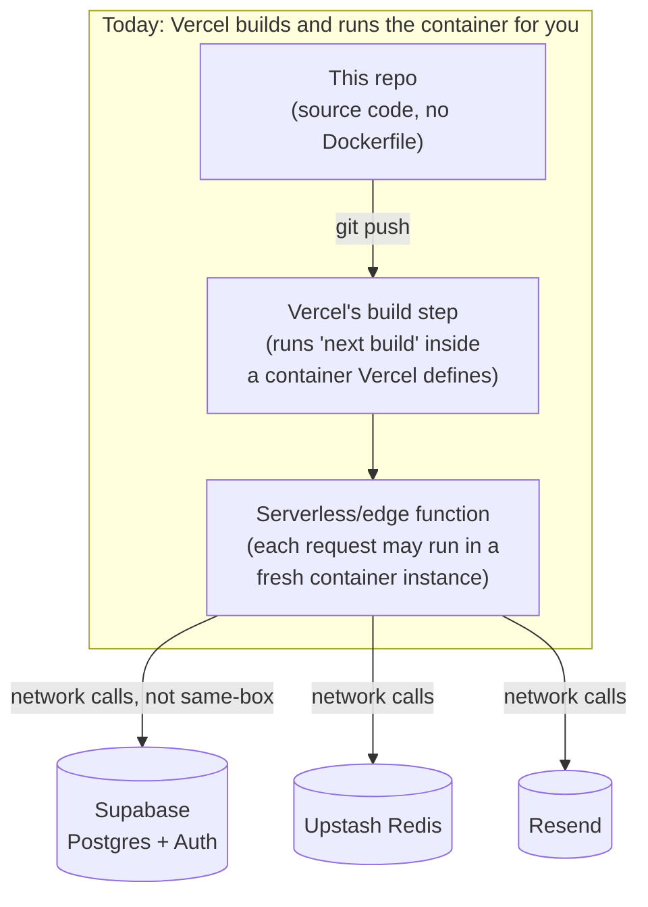

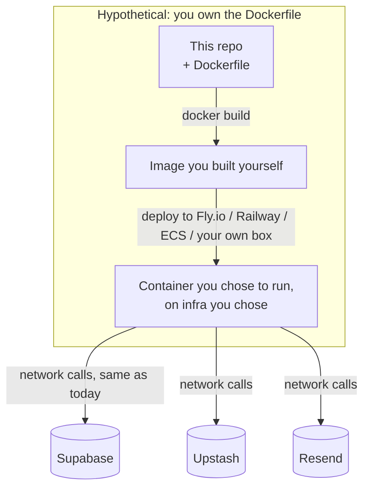

The two diagrams look almost identical on the right-hand side on purpose:
**Supabase, Upstash, and Resend don't change at all.** They're managed
services reached over the network either way — nothing about them gets
containerized by this repo in either world, because you don't own or run
those servers. The only thing that would change is *who builds the
container the Next.js app runs in, and where it's deployed* — everything
left of that stays identical.

| | **Today (Vercel)** | **Hypothetical (Docker, self-managed)** |
|---|---|---|
| **Who writes the container recipe** | Vercel (invisible to you) — it infers how to build/run a Next.js app | You — a `Dockerfile` you write and maintain in this repo |
| **Where it runs** | Vercel's infrastructure only | Anywhere Docker runs: Fly.io, Railway, AWS ECS, your own server |
| **Local dev** | `next dev` directly on your machine, no container involved | Optionally `docker compose up`, so dev matches prod exactly |
| **Scaling / load balancing** | Automatic, platform-managed ([§5](#5-load-balancer-and-reverse-proxy)) | You configure it (the platform's autoscaling, or your own) |
| **Preview deployments per PR, image optimization, edge functions** | Built in, zero config | You'd rebuild or lose these, depending on the target platform |
| **What you maintain** | Nothing infra-side | Dockerfile, base-image updates/security patches, deploy pipeline |

### Deep dive — local Postgres already uses Docker, just not for the app
One nuance worth knowing: if this project uses the Supabase CLI for local
development (`supabase start`), **that already runs Docker Compose under
the hood** — a local Postgres, a local Auth service, a local Studio UI,
all as containers — even though there's no `docker-compose.yml` checked
into this repo. That's Supabase's own tooling doing it for you, the same
"someone else owns the container" pattern as Vercel, just for the
database piece instead of the app piece. So in a real sense, Docker is
already part of this project's toolchain today — it's just not something
you, personally, configure or maintain.

### When to consider switching

| Trigger | Why it would push toward Docker | Splitiful today |
|---|---|---|
| **Leaving Vercel** (cost, a feature Vercel doesn't support, wanting a specific region/cloud) | A Dockerfile is the portable unit almost every other host accepts | Not happening — no stated reason to leave |
| **A long-running process** Vercel's serverless functions can't do well (a persistent WebSocket server, a background worker polling a queue continuously) | Containers can run indefinitely; serverless functions are built to start, finish, and stop | Nothing in the roadmap needs this — see [§9](#9-asynchronism-and-queues), still synchronous |
| **Needing the exact same runtime in dev, CI, and prod** because subtle environment differences have caused real bugs | A container is byte-for-byte the same everywhere | Hasn't come up — `next dev` has been sufficient |
| **Compliance/data-residency requirements** that require self-hosting rather than using someone else's managed platform | You control exactly where and how the container runs | No such requirement exists for this project |
| **Team/process reasons** — e.g. wanting infra-as-code parity across many services, or a platform team standardizing everything on Kubernetes | Containers are the common denominator most orchestration tooling expects | Splitiful is a monolith with one deploy target ([§6](#6-application-layer-monolith-modular-monolith-and-microservices)) — no such standardization pressure yet |

None of these are true for Splitiful right now. This is the same pattern
as [§8 Caching](#8-caching) and [§9 Async/queues](#9-asynchronism-and-queues):
the right move is recognizing there's no problem this would solve today,
not pre-building infrastructure for a scenario that hasn't happened. If
one of the triggers above ever becomes real, the migration itself is
small — Next.js has an official ["standalone" output mode](../../node_modules/next/dist/docs)
specifically meant to make writing that first Dockerfile straightforward
whenever it's actually needed.

---

## 14. Glossary

Quick lookup for terms used throughout this document.

| Term | Meaning |
|---|---|
| API | An agreed-upon way for one program to ask another to do something |
| Async / asynchronous | "Do this later, don't make me wait" — as opposed to synchronous |
| Cache | A faster, temporary copy of data kept to avoid redoing slow work |
| CDN | Servers spread globally that serve static files from near the user |
| Client | The program making a request — usually a browser |
| DNS | The system that turns domain names into server addresses |
| Fire-and-forget | The caller sends a request and moves on without waiting for (or acting on) the response — not the same as a queue, since there's no retry or guarantee it ever completes |
| Latency | How long a request takes |
| Least privilege | Every part of a system should be able to do only what it actually needs to, nothing more |
| Load balancer | Spreads incoming requests across multiple server copies |
| Microservices | An app split into several small, independently-run services |
| Monolith | An app built and deployed as one single unit |
| Queue | A waiting line for tasks to be processed later, usually by a background worker |
| Rate limiting | Capping how many requests a caller can make in a given time window, to stop abuse (e.g. guessing a low-entropy code) rather than to control who's allowed to read/write data at all |
| Replication | Keeping synced copies of a database |
| Reverse proxy | Code that inspects/redirects every request before it reaches the real app logic |
| RLS (Row-Level Security) | A database feature that restricts which rows a query can see/change, enforced by the database itself |
| RPC | An API style built around calling named actions/functions |
| REST | An API style built around nouns (resources) and standard verbs (GET/POST/etc.) |
| RDBMS | Relational database management system — a database that uses tables with rows/columns |
| Server | A program that waits for and responds to requests |
| Sharding | Splitting one database into multiple, each holding a slice of the data |
| Synchronous | The caller waits for the full result before continuing |

---

*Companion to the conversation that walked through the
[system-design-primer](https://github.com/donnemartin/system-design-primer)
using this codebase. See the [architecture overview](../architecture/overview.md) for the
current-state architecture snapshot this document explains, and
[`adr/`](../adr) for the reasoning behind specific decisions referenced
above.*
